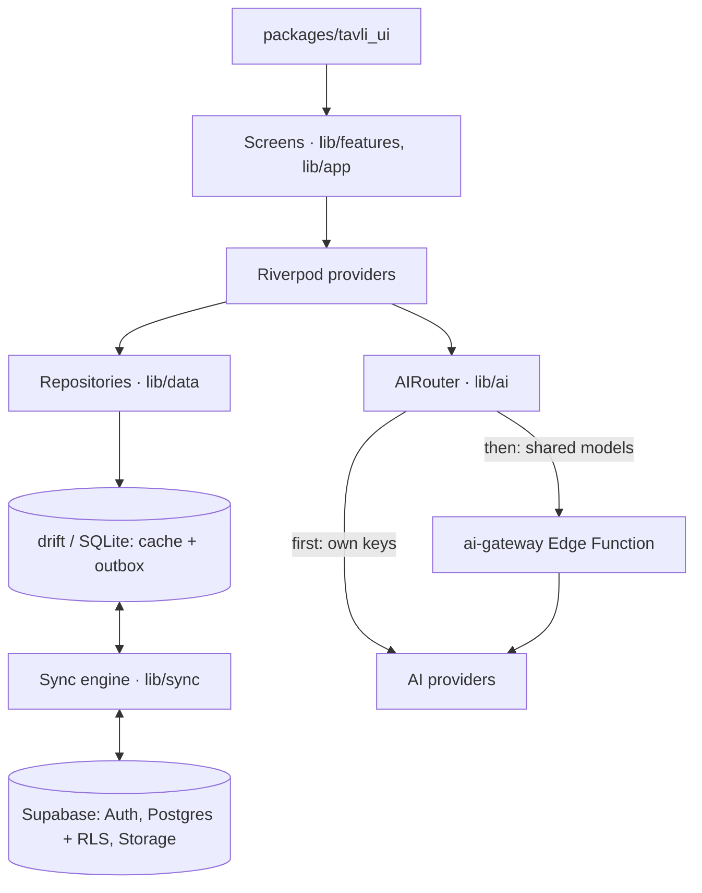

<p align="center">
  
</p>

<h1 align="center">Tavli</h1>

<p align="center">
  <strong>From meal planning to organized shopping and cooking.</strong><br>
  Recipes, meal plans, shopping lists and a pantry, shared with your household.
</p>

<p align="center">
  <a href="#what-you-can-do">Features</a> ·
  <a href="#architecture">Architecture</a> ·
  <a href="#getting-started">Getting started</a> ·
  <a href="#development">Development</a> ·
  <a href="#documentation">Documentation</a>
</p>

---

## About

Tavli answers "what are we eating, and what do we need to buy?" in one app. Save a
recipe from a photo, a dish name or your voice, turn your recipes into a weekly or
monthly plan, and shop from a list that already knows what the plan needs.

- **One Flutter codebase** for Android, iOS, macOS and Windows, with layouts for phones
  and wide screens. A Linux build runs in CI.
- **Works offline.** Data is cached on the device and synced to your account. AI,
  cookbooks and account actions need a connection.
- **Made for households.** Members share recipes, plans, shopping and the pantry.
- **AI proposes, you approve.** Suggestions are shown for review before they are saved.

The interface is in Serbian (Latin script); engineering documentation is in English.

> [!NOTE]
> Tavli is in active development. This page describes the `dev` branch and is not a
> claim that every feature is released or finished on every platform. See the
> [roadmap](docs/roadmap.md) for what is built and what is still planned.

## What you can do

The app has five tabs, named below as they appear on screen, plus a profile.

### Recepti (Recipes)

- Add a recipe from a **photo**, a **dish name**, your **voice**, a **cookbook
  answer**, or **by hand**.
- Change a recipe by **chatting with AI** ("for 4 people", "gluten-free"), then
  accept the proposal, undo it, or restore an earlier version.
- Search by name and filter by meal, weight, kind of dish and preparation time.
- Rate recipes, mark favorites and keep a private note.
- Find saved recipes that match the pantry with **Šta da skuvam?** (What can I cook?).
- Follow **cooking mode**: one step at a time, with step timers and the screen kept on.
- When enabled on the server, recipes made by AI get an AI-generated image in the
  background, labeled as such; your own photo is never replaced.

### Plan (Meal plan)

- Generate a **week or a month** for the meals and servings you choose, optionally
  using the pantry and special requests.
- Review the proposal, swap single meals for another suggestion or your own recipe,
  and only then save it.
- Use the tastes and favorites that household members chose to share.
- Add any saved recipe directly to a day, and lock meals you want to keep.

### Nabavka (Shopping)

- Shop **from a plan** or **from individual recipes**, by week or for the whole plan,
  grouped by category.
- See which meals an item is for, add your own items, and take pantry stock into account.
- Move purchased items to the pantry.

### Početna (Home)

- See today's and tomorrow's meals, start cooking, and mark a meal cooked (with undo).
- See one notice at a time, such as missing ingredients or a plan about to end.
- Check **Post i praznici** (fasting and holidays), based on the Serbian Orthodox
  calendar, ask questions, and start a fasting plan.

### Ostava (Pantry)

- Keep a simple list of what you have; quantities are optional.
- Add items by hand or from a **photo** of a product, shelf or fridge, after review.

### Household, cookbooks and profile

- **Household:** invite members with a QR code, code or link, and join an existing one.
- **Cookbooks:** upload text-based PDF or EPUB books and ask questions. Answers cite the
  book and page, and only your household can see the books.
- **Tastes and allergens:** record likes, dislikes, cuisines, favorites and allergens. Tastes and favorites feed plan generation; allergens are saved but not yet applied to plans.
- **Appearance:** three themes (Bosiljak, Šafran, Borovnica) in light, dark or system mode.
- **AI keys:** optionally add your own Gemini, Groq, OpenRouter or OpenAI key, and
  choose whether paid or free services are tried first.

## Architecture

The app reads and writes a local database first. A sync engine exchanges changes with
Supabase, and all text and photo AI tasks in the app go through one router.



| Area | Technology |
| --- | --- |
| App | Flutter, Dart, Material 3 |
| State and navigation | Riverpod, go_router |
| Local data | drift (SQLite) |
| Backend | Supabase Auth, Postgres with Row Level Security, Storage, Realtime signals and Edge Functions (Deno) |
| UI | `packages/tavli_ui`: themes, tokens, components, icons, motion |
| AI | Gemini, Groq, OpenRouter and OpenAI through one OpenAI-compatible client |

### Repository layout

This is one repository with a Dart pub workspace: the app at the root and a local UI package.

```text
lib/
  app/         app shell, router, theme choice, animations
  features/    screens and providers: home, planning, shopping, recipes, pantry,
               cookbooks, fasting, account, settings
  domain/      business rules in pure Dart, no Flutter
  data/        repositories, drift schema, photos
  sync/        outbox upload, download, photos, realtime signals
  ai/          task facades, prompts, validation, AIRouter, key storage
  account/     authentication, session, account scope
packages/
  tavli_ui/    local design system package
supabase/
  migrations/  schema, Row Level Security, grants
  functions/   Edge Functions (AI, cookbooks, voice, household, account)
  tests/       pgTAP database tests
  templates/   sign-in and confirmation emails
test/          Dart tests mirroring lib/, with fake AI and backend
evals/         AI evaluation cases and results
site/          static email confirmation page
docs/          architecture, product and development guides
```

### Data and sync

1. A repository writes the change and an **outbox** entry in one drift transaction.
2. The UI updates from drift right away, online or offline.
3. The sync engine uploads the outbox and downloads remote changes. Realtime signals
   prompt a download while the app is in the foreground.
4. Postgres **Row Level Security** enforces access on the server.

### How AI is called

1. For each task, `AIRouter` walks an ordered chain of models. It tries the **user's own
   keys first** (paid or free first, as chosen) and calls those providers directly.
2. If none succeeds, it continues with the **shared models** through the `ai-gateway`
   Edge Function. The gateway checks the signed-in user and usage limits before adding
   the server-side provider key. Its provider order is set by a server secret.
3. Rate-limited or unavailable models are skipped for a while. Responses are validated,
   and an invalid one gets one repair attempt.

The user's own keys stay in the device's secure storage. Shared provider keys live only
on the server; app builds carry none. Voice transcription, cookbooks, planning inputs
and AI images also run through Edge Functions, with the same quota.

More detail: [architecture](docs/architecture.md) and [flow map](docs/flows.md).

## Getting started

### Requirements

- [Flutter](https://docs.flutter.dev/get-started/install) **3.50.0** stable, the version used in CI
- The native toolchain for your target platform (check with `flutter doctor`)
- Python 3 for the repository check scripts
- Docker and the [Supabase CLI](https://supabase.com/docs/guides/local-development) for the local backend
- [Deno](https://deno.com/) 2 for Edge Function tests (optional)

### Run the app

```bash
git clone https://github.com/anjahubac/tavli.git
cd tavli
flutter pub get
git config core.hooksPath .githooks   # enable the pre-commit checks, once per clone

supabase start                        # local backend in Docker
cp -n secrets.example.json secrets.json  # then fill in the values below
flutter run -d macos --dart-define-from-file=secrets.json
```

Use `flutter devices` to find another target. On Windows, `scripts/build-windows.ps1`
builds the app and registers the `tavli://` links used by email confirmation. Local sign-in emails arrive in the mail
catcher at <http://localhost:55324>.

### Configuration

| Name | Purpose |
| --- | --- |
| `SUPABASE_URL` | Backend URL; for local work, take it from `supabase status` |
| `SUPABASE_ANON_KEY` | Public client key; for local work, take it from `supabase status` |
| `AUTH_CONFIRM_PAGE_URL` | Email confirmation page; locally, delete this line so email links open the app directly |

`secrets.json` and `secrets.*.json` are gitignored. **Never commit keys**, and never put a
Supabase service-role key or a shared AI provider key in the app. The app needs no AI
keys. The shared AI features (gateway, voice, cookbooks) need the Edge Functions served
with their own provider secrets, which are not part of this repository; for local work,
add your own key in the app's profile.

| Local service | Port |
| --- | --- |
| API | 55321 |
| Database | 55322 |
| Studio | 55323 |
| Mail | 55324 |

For platform-specific setup, see [Windows](docs/development/windows.md) and
[Linux](docs/development/linux.md).

## Development

| Task | Command |
| --- | --- |
| Format check and static analysis | `scripts/check.sh` |
| Tests affected by your branch | `scripts/test-changed.sh origin/dev` |
| All app tests | `flutter test` |
| UI package tests | `cd packages/tavli_ui && flutter test` |
| Database tests (local stack) | `supabase test db` |
| Edge Function tests | `deno test supabase/functions` |
| Documentation checks | `python3 scripts/check-docs.py` |
| Regenerate drift code | `dart run build_runner build --delete-conflicting-outputs` |
| Reset the local database | `supabase db reset` (erases local data) |

App tests use fakes and need no keys. Component image tests are compared on Linux; see
`scripts/update-goldens.sh`.

### Contributing

1. Branch from the latest `dev`, for example `feat/short-name` or `fix/short-name`.
2. Keep the change focused and add tests for changed behavior.
3. Open a pull request into `dev`. CI must pass, and another developer reviews it.

`dev` is the integration branch and `main` is production. Pull request titles follow
Conventional Commits, for example `fix(shopping): keep bought items`. Read
[AGENTS.md](AGENTS.md) and the [team workflow](docs/development/team-workflow.md) first.

## Documentation

| Guide | What it covers |
| --- | --- |
| [Documentation index](docs/README.md) | Reading order and all maintained documents |
| [Architecture](docs/architecture.md) | Layers, data, sync and AI |
| [Flow map](docs/flows.md) | How plan, shopping, pantry and cooking connect |
| [Product design](docs/product-design.md) | Product decisions and intended flows |
| [Roadmap](docs/roadmap.md) | Planned direction |
| [Flutter practices](docs/flutter-best-practices.md) | Coding and Git conventions |
| [UI standard](docs/development/ui-standard.md) | Design rules, sizing and accessibility |
| [UI package](packages/tavli_ui/README.md) | Using and extending `tavli_ui` |
| [Testing](docs/development/testing.md) | What to test and how |
| [Quality gates](docs/development/quality-gates.md) | Required checks by type of change |
| [Security](docs/development/security.md) | Security baseline and known gaps |
