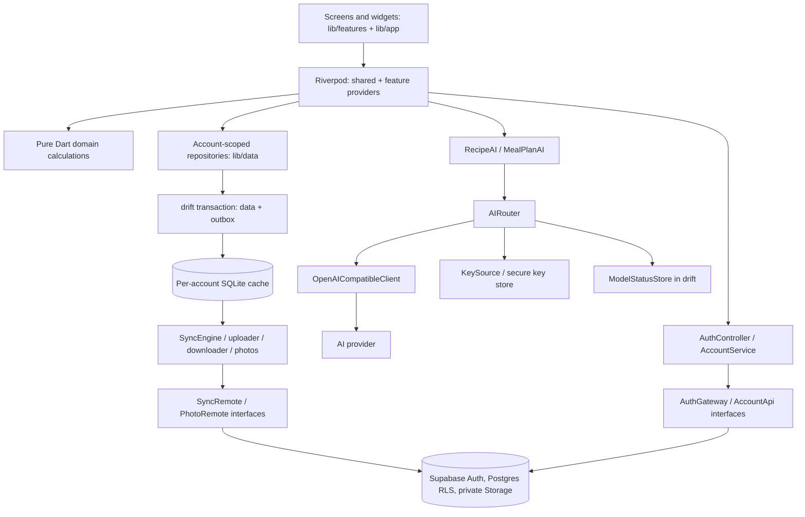
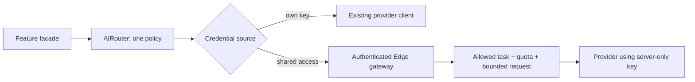

# Tavli application architecture

Reviewed: 2026-11-13. Evidence baseline: `main` at `1eca2c3`, `dev` at
`207c94c`. Brought up to date with `dev` at `ebcd794` on 2026-11-24 (drift
schema 14, 46 SQL migrations, 9 Edge Functions). This describes **anjahubac/tavli**, not `tavli-next`.
Code presence is not a claim of production acceptance or a successful test run.
See [review findings](development/review-2026-11-13.md) and
[product plan](product-plan.md) for the accepted evolution.

## 1. Current stack and repository layout

One Flutter application targets Android, iOS, macOS and Windows; a Linux GTK
runner also builds in CI ([Linux development](development/linux.md)). A web/PWA
target (`web/`, [spec 036](../specs/036-pwa-web/spec.md)) serves the same code in
Safari and Chrome; it has no own AI keys, keeps the session in browser storage and
uses IndexedDB for recipe photos. It is not released or accepted yet. The Windows
x64 runner, in-window title bar and menu, and local MSIX packaging are documented
in [Windows development](development/windows.md); public distribution is not yet
claimed. Dart's constraint is
`^3.13.7` in `pubspec.yaml`; obtain exact packages from `pubspec.lock`, not this
prose. Material 3, Riverpod, go_router, drift/SQLite, dio, the pure-Dart Supabase
client, secure storage, image_picker, mobile_scanner (household QR), record
(voice), qr_flutter, share_plus, app_links (`tavli://` links) and wakelock_plus are
already used. No new framework,
package layout or generic event bus is required by the team standards.

| Existing path | Responsibility | Boundary |
| --- | --- | --- |
| `lib/main.dart`, `lib/app/app.dart` | ProviderScope, MaterialApp and lifecycle | App composition, not feature business rules |
| `lib/app/router.dart`, `home_shell.dart`, `tab_app_bar.dart` | Routes, adaptive shell, shared top bar | Dev 4 coordinates route changes |
| `packages/tavli_ui/` | Local UI package: palettes, theme, semantic colors, spacing/radius/motion tokens, `TavliPlatform`, font | Depends only on Flutter; app imports `package:tavli_ui/tavli_ui.dart` only |
| `lib/app/theme_controller.dart`, `lib/app/animations/` | Persisted appearance choice and reduced-motion painters | Reuse package tokens; no app logic in the package |
| `lib/providers.dart` | Shared dependency wiring, auth scope, sync/router/client construction | Feature-level providers remain beside their features |
| `lib/features/recipes/` | Recipe list/detail, photo/name/voice/manual inputs, AI preview/chat, filters and labels, ratings and favorites, add to plan, "Šta da skuvam?", cooking mode with timers, AI images, original photo and versions | Compose reusable ingredient/personal/cooking widgets here |
| `lib/features/home/` | Today's and tomorrow's meals, cook/undo, one prioritized notice, fasting status card | A view over the approved plan, not a separate store |
| `lib/features/pantry/` | Ostava list, add/edit/remove, add from a photo | Uses `pantry_repository`; no expiry UI |
| `lib/features/cookbooks/`, `lib/features/fasting/` | Household cookbook upload and questions; fasting and holiday questions | Server work happens in Edge Functions; UI only calls repositories |
| `lib/features/planning/` | Setup, draft progress/preview, calendar and meal actions | Draft state is separate from accepted plan data |
| `lib/features/shopping/` | Plan/recipe mode, list UI and providers | Reconciliation is in repositories/domain |
| `lib/features/account/`, `settings/` | Auth screens, household setup, invitation share/scan/join, sync status, profile, appearance, tastes and allergens, own AI keys | No direct backend calls in widgets |
| `lib/domain/` | Pure Dart recipes, calendar dates, meal plans, demand, sources, sync and allocation calculations | No Flutter or network imports |
| `lib/data/` | Account-scoped repositories, drift schema, photos, settings and cooldown persistence | Persistent business operations and transactions |
| `lib/account/` | AuthGateway, AccountApi/Service, AuthController, AccountScope, SessionStore | Supabase hidden behind fakeable interfaces |
| `lib/ai/` | Task facades, prompts, parsers, AIRouter, ChatClient, chains and credentials | All feature AI goes through AIRouter |
| `lib/sync/` | SyncedWriter, registry, uploader/downloader, photos, legacy migration, scheduler and realtime signals | Network synchronization, not UI state |
| `supabase/migrations/`, `tests/`, `functions/`, `templates/` | SQL/RLS, pgTAP, Edge Functions (`ai-gateway`, `voice-transcribe`, `planning-inputs`, `cookbook-process`, `cookbook-ask`, `household-invite`, `household-join`, `household-photo-cleanup`, `delete-account`) and email templates | Applied SQL immutable; hosted changes via reviewed deployment |
| `site/`, `evals/` | Static email confirmation page (Cloudflare Pages); AI evaluation cases and traces | Page holds no keys; evals use recorded traces |
| `test/`, `scripts/` | Mirrored tests, fake backend/AI, format/analyze and affected tests | Synthetic data, local services only |
| `specs/`, `.specify/`, `.claude/skills/` | Acceptance, contracts, workflow templates and installed Spec Kit commands | Versioned product/engineering decisions |

Pantry tables, `lib/data/pantry_repository.dart` and the Ostava screens in
`lib/features/pantry/` exist (spec 022). So do the tastes and allergens screen,
the household flow (setup, invitation by link, QR or code, join, departure and
removal), the Home screen, cookbooks, fasting questions and the voice recipe
agent. The nutrition diary and calorie strip, store prices, receipt QR, cycle
hints and nutritionist plan import do not exist; nutrition has only
reference values and per-recipe calculation (`lib/domain/recipe_nutrition.dart`)
with no screen. Create the files of such features only when they are specified.

## 2. Dependency boundaries

The UI reads drift-backed streams through Riverpod; widgets forward intent to
services/repositories. UI never fetches Supabase tables or calls an AI provider.
Domain calculations are deterministic; clocks/transports are injected. Existing
shared providers stay in `lib/providers.dart`; do not invent a parallel DI layer.

## 3. Account and data lifecycle

An account is mandatory. Auth states (`Starting`, `SignedOut`, `CodeSent`,
`ConfirmSent`, `NeedsName`, `NeedsHousehold`, `SignedIn`) control route access and the one-time
name step. Sign-in (`/sign-in`) only sends a code to an existing account
(`shouldCreateUser: false`, unknown address → `NoAccount`). Sign-up
(`/sign-up`) creates the account and sends the confirmation email, which has a
"Potvrdi adresu" button and the same 6-digit code. On hosted projects the
button lands on the static "Uspešna registracija" page (`site/potvrda/`, Cloudflare
Pages, URL in `AUTH_CONFIRM_PAGE_URL`), whose "Otvori Tavli" button passes the
same code on to `tavli://auth-callback?code=…`; locally the button goes straight
to `tavli://auth-callback`. The app exchanges the code with the PKCE
verifier kept in secure storage (`PkceStorage`); the page holds no keys and
sends nothing anywhere. Android, iOS and macOS register the `tavli` scheme.
The [local Windows build script](development/windows.md) registers the scheme
for the current user and points it to the selected Debug or Release executable.
Windows also registers the scheme when installing the MSIX package. On Windows
the user can type the code from the email as well.
The name is asked once: with no cached name the app checks the server profile
before showing the name step. A mandatory "Tvoje domaćinstvo" step follows: the
person names a household or joins one with an invitation code. Apple/Google remain future work. Session tokens live
in secure storage, not drift or logs. Email OTP length, confirmation templates
and redirect settings must agree for each local/dev/production environment;
configure them explicitly rather than assuming the email template determines
code length. Never inspect real session/credential values during tests.

Supabase is the durable account-backed store. drift is the UI's working cache,
not a second independent source of business truth. Household records include
recipes, plan, pantry and shopping; personal records include profile/ratings.
Every read/write uses `AccountScope`. Sign-out clears access/session without
removing server or per-account cached data. Account deletion is a separate
explicit operation through `delete-account`, then local cleanup after success.

### Writes, retry and reads

1. User confirms a business operation.
2. Repository validates current state and computes domain changes.
3. One drift transaction writes rows and outbox entries through `SyncedWriter`.
4. UI immediately observes the local result; `SyncEngine.kick()` schedules upload.
5. `Uploader` reads current payloads for queued identities. Primary-key upserts
   protect against duplicate rows, while replaying a mutable upsert can still
   overwrite a newer server value. Rejected entries are reported and other work
   continues.
6. `Downloader` preserves pending local edits. A row with invalid data or a local
   constraint violation rolls back independently. Later independent rows and
   tables are applied. The stored cursor stays before the first failing or
   dependent row so both are retried. Photos synchronize separately.

Current scheduler pushes on start/login/resume/local change, debounces local
writes for 1 s and retries offline at 5/10/30 s. Pull runs on start/login and
resume when the 15-minute threshold has elapsed. While the app is in the
foreground, `RealtimeSync` also listens to authenticated signal rows
(`account_sync_signals`, `household_sync_signals`) and starts a pull after a signal;
a 15-minute fallback timer and reconnect recovery cover a missed one. Signals
carry no business data. They only trigger the same pull path and never become an
alternative UI database. Last server write wins for record edits; deletion
tombstones prevent resurrection.

The ingredient catalog (`foods`, `food_aliases`, spec 018; reviewed seed, nutrition
reference values and allergen groups per food) downloads read-only
after the household entities and before tombstones, through `catalogEntities`
outside the generic `syncEntities` loop. A server without the tables or a
denied household read never stops the rest of the download (`CatalogStatus`).
`FoodCatalogReader` builds the matcher from the local cache. Household catalog
writes are not implemented yet; when added they become ordinary outbox-backed
writes. Shared prices remain planned as read-only reference data. Current theme/settings, the
own-key order and AI keys remain device-local. Planned cycle data is a deliberate device-only secure
exception; do not add it to the generic sync/export pipeline.

## 4. Existing planning and shopping invariants

`MealPlanAI` and planning feature providers generate in-session drafts. Approval
persists through `MealPlanRepository`. `MealType` has breakfast, morning
snack, lunch, afternoon snack and dinner in day order; a plan stores the chosen
types as a list and each meal as its own entry, and an entry with a type this
client does not know is skipped instead of shown as lunch.
`CivilDate` represents calendar days in domain code; persisted plan and weekly-list
days are server `date` columns since the `calendar_dates` migration (spec 016),
while instants stay UTC timestamps.

The drift schema version is **14** (`lib/data/database.dart`, 2026-11-24). It
includes approved recipe snapshots/servings, source headers, contributions,
supply allocations, pantry receipts and consumptions, weekly shopping periods,
cooked events, ratings, favorites, allergen selections, tastes and the catalog
cache (foods, aliases, nutrition reference). Never pick the next version
independently in parallel branches: check current `dev` and coordinate before
each schema PR.

- Plan entries reference the approved snapshot. Later library changes/deletion
  must not silently change shopping quantities or remove cooking information.
- A standalone preparation has a stable identity. Repeating Add updates only the
  difference; intentionally preparing the dish again creates a new source.
- Month view aggregates canonical weekly lists; a month may intersect six weeks.
- Demand and supply retain provenance. One pantry quantity is allocated only
  once across plan and recipe shopping. A purchase and its pantry receipt are
  the same supply, not two independent credits.
- Bought/manual rows survive reconciliation. Unknown units/quantities stay
  visible for checking; never guess a conversion silently.
- Current `PantryRepository.receiveBought` is idempotent. The new explicit
  transfer/consumption behavior is an extension, not an invitation to rewrite
  the shopping ledger without regression fixtures.

Preserve these rules during catalog normalization and shared cooking operations.
Test local rollback, duplicate event/retry, undo, account switch and deletion.

## 5. Runtime AI

Current: `RecipeAI`/`MealPlanAI`/`PantryAI`/`VoiceAgent` → `AIRouter` → fakeable
`ChatClient` (dio).
`ChainConfig` owns models/capabilities; `KeySource` supplies own keys
(paid or free services first, `OwnKeyOrder`); the gateway comes after them. Model
cooldown state persists in drift. Parsers throw
`FormatException` for shape/domain mismatch; the router has bounded repair and
fallback. UI receives typed errors mapped to Serbian. JSON-object decoding alone
is not sufficient semantic validation.

Shared access uses a gateway transport through a Supabase Edge Function, behind
the same feature/router boundaries. Server validates
identity, allowed tasks, size/budget and per-user limits, then adds provider
credentials. Bring-your-own keys stay in secure device storage and use the
direct transport, before the gateway. The gateway serves the ordered shared text and photo
model lists and runs one provider attempt per completion. AIRouter owns fallback,
repair and cancellation. See [the 015 integration plan](../specs/015-ai-server-gateway/plan.md)
for the Flutter cutover and current verification status.

App builds contain no shared provider keys. The app reads only Supabase
client configuration and passes its session token to the Edge Function. Older
builds that shipped shared provider keys still need the cutover and rotation
procedure in 015.

Server-side AI features beyond chat completion, all behind `verify_jwt` and the
same `ai_reserve`/`ai_release` quota used by the gateway:

- **Gateway** (`ai-gateway`): text and photo tasks plus `recipe_image`. The shared
  chain is ordered by the optional `AI_PROVIDER_ORDER` secret; an OpenAI model is
  first only when `AI_OPENAI_ENABLED` is `1`; `AI_GATEWAY_DISABLED=1` switches it
  off. Provider keys are function secrets only. AI images need
  `AI_IMAGES_ENABLED=1` and Cloudflare credentials; they are generated in the
  background for AI recipes, stored under the
  household's private path and never replace the person's own photo.
- **Cookbooks** (`cookbook-process`, `cookbook-ask`): private household PDF/EPUB
  with real text (scans are rejected); chunks are embedded, retrieval is filtered
  to the caller's household books in the database, and every answer carries book
  and page from the database, never from the model. The Home fasting card reuses
  this path for questions answered from recipes and cookbooks.
- **Voice** (`voice-transcribe`): press-to-talk recording is transcribed
  server-side, then `VoiceAgent` turns the transcript into allowlisted actions on
  a recipe draft that the person reviews in the manual form. Nothing is recorded in
  the background.
- **Planning inputs** (`planning-inputs`): returns the consent-filtered member
  tastes and favorites the planner may use.

Imported nutritionist plans do not exist yet; when added they are reviewed,
preserve exact quantities and protect locked meals.

## 6. Accepted product evolution and privacy

Target tabs: Plan, Nabavka, **Početna**, Recepti, Ostava; profile via avatar.
Code has these five tabs (wide menu: Home first); `/home` is default.
Home, pantry and cooking extend existing planning/shopping repositories; they do
not create a second plan store. Home (`/home`, the default) shows today's and
tomorrow's meals, "Kuvaj" and "Skuvano" with undo, one notice (missing shopping
today/tomorrow, then plan ending) and the "Post i praznici" card.
Keep route compatibility and auth gates during the transition.

Catalog: stable UUID + readable slug, aliases, base units, conversions and
nutrition provenance; do not copy `tavli-next` identifiers/schema blindly.
Ingredient snapshots preserve original text and optional catalog mapping.
Pantry has optional quantity, no expiry UX and no “use first” subsystem. Numeric
stock is consumed once when cooked and restored on undo; unknown stock persists
until removed. `CookingRepository` (cooked events) and `PantryRepository`
(consumptions) implement this in one transaction with the outbox; the full
ledger contract and its replay fixtures are still being completed.

Household planning targets a consent-filtered aggregate of selected members'
tastes, notes and favorites, defaulting to all current members. Personal profile
and diary rows stay owner-only. The 2026-11-21 decision keeps participant
allergen selections within the future server planner for candidate filtering and
final checks. The current planner does not apply allergen selections yet: the
tastes screen stores them (`user_allergen_selections`) and the catalog carries
allergen groups per food, but neither generation nor `planning-inputs` filters
by them. See
the [008 contract](../specs/008-household-members/contracts/member-planning-inputs.md)
and [logic-first plan](../specs/008-household-members/plan.md). Cycle dates never
leave the device; only an explicitly approved generic dietary hint can enter a request.

Nutrition is optional, off by default, computed from attributed reference values,
not numbers invented by AI. Personal intake/targets stay private. Cookbooks and
receipt/price integrations need source/legal/retention decisions before shipping.
See [shared contracts](../specs/011-team-development/contracts/shared-boundaries.md).

## 7. Team and verification boundaries

Dev 1 coordinates data/schema and shopping; Dev 2 owns AI/planning; Dev 3 owns
identity/personal data; Dev 4 owns shell/everyday UX/platforms. Each owns complete
feature slices in the current layers, with consumer review at shared boundaries.
No developer exclusively owns all of `lib/domain/` or `lib/data/`.

Each domain/parser change has behavioral tests; UI key flows use widget tests;
RLS/storage use two-account pgTAP locally. Fake provider/backend interfaces keep
default Flutter unit/widget tests offline. Platform smoke tests and UX evaluation remain explicit
release evidence. See [quality gates](development/quality-gates.md).

An architecture change requires a short decision record: problem, alternatives,
chosen boundary, owner/consumers, data migration and acceptance tests. Standards
must follow the verified repository, never an imagined future folder tree.

## 8. Security boundaries and known gaps

[Security assessment](development/security.md) records the source-level baseline:
RLS/grants/private storage and secure session storage exist; shared provider
credentials are no longer read by the client (server secrets only). Unchecked photo
paths, raw error propagation and missing SQL/function deployment gates still need
dedicated remediation. Environment/cache
protection needs review before sensitive-data features. These are tracked in
[012](../specs/012-security-baseline/spec.md); no architecture diagram or rule
change constitutes a runtime fix. Server authorization remains mandatory even
when a modified client bypasses all Flutter validation.
