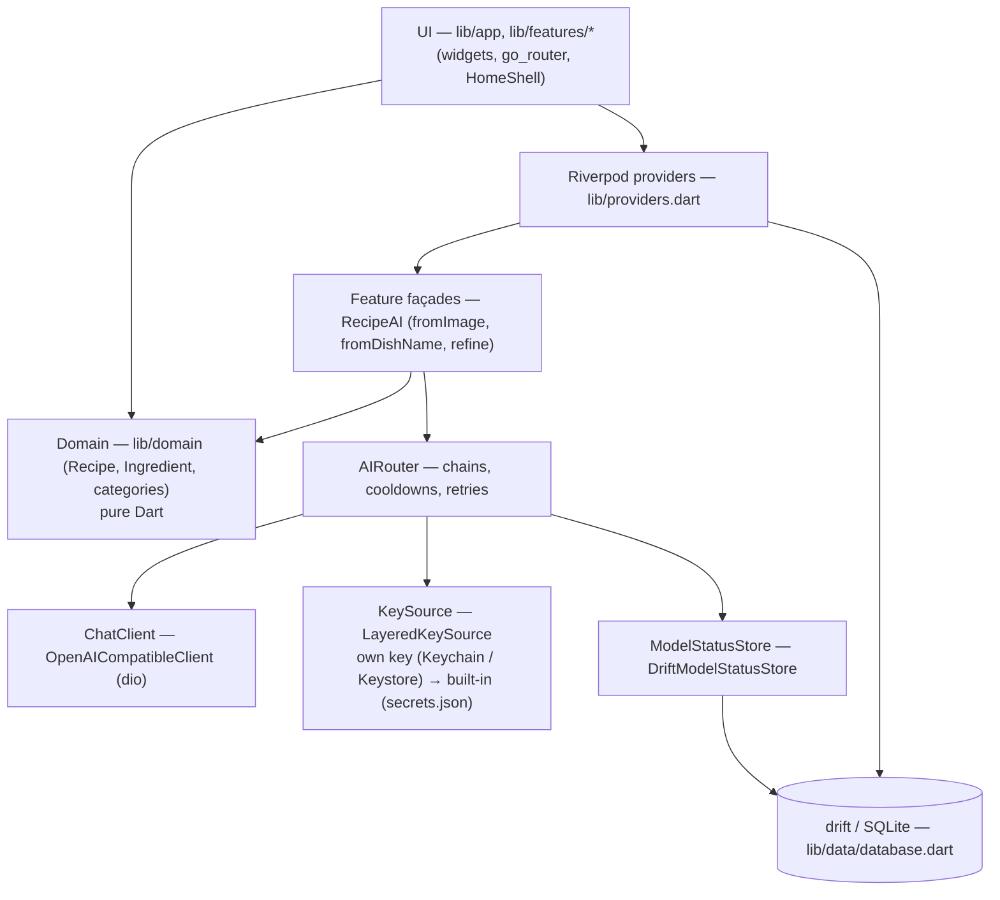
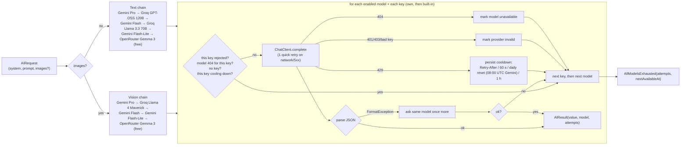

# Tavli architecture

## Layers

- **UI** reads state through Riverpod and never calls `ChatClient` or providers directly.
- **Domain** is pure Dart; `Recipe.fromAiJson` throws `FormatException` on bad AI output.
- **Data**: one drift database (`tavli`) with tables for recipes, recipe versions,
  pantry, shopping lists/items, meal plans/entries, ratings, user profile,
  app settings and model status. Lists inside rows (ingredients, steps, meal
  types) are stored as JSON text.
- **Recipes** (spec 003): `RecipeRepository` (`lib/data/recipe_repository.dart`)
  owns recipe rows and versions. Every change (AI, manual, restore) stores the
  *previous* state in `RecipeVersions` with `changeKind`/`instruction`/`changedBy`
  (max 30 per recipe); undo applies and deletes the newest version, restore keeps
  the current state as a new version. Photos are downscaled to JPEG (≤ 1600 px)
  in an isolate and stored as files under `<documents>/recipe_photos/`; the DB
  keeps the relative path (`RecipePhotoStore`).

## Navigation

`StatefulShellRoute.indexedStack` with five tabs: Recepti, Plan, Ostava,
Kupovina, Profil. `HomeShell` shows a bottom `NavigationBar` below 720 px and a
`NavigationRail` at ≥720 px (extended at ≥1000 px). `/profile/ai-keys` is the
AI keys screen.

Recipe routes: `/recipes` (list), `/recipes/new/{name,photo,manual}`,
`/recipes/:id` (detail), `/recipes/:id/edit`, `/recipes/:id/chat`. When the
content area is ≥ 840 px wide, `/recipes/:id` shows the list and the recipe side
by side (`RecipeRoute`), otherwise the detail is a full screen.

## AI router and fallback chains

Key points:

- Chains live in `ChainConfig` (`defaults`), filtered by `enabled` and, for
  vision, `supportsVision`. The config is read through a function so the user
  can change it at runtime.
- For each model the router tries every credential from `KeySource` in order
  (own key, then built-in Tavli key) before moving to the next model.
- Cooldowns and per-day request counts persist in the `ModelStatuses` table
  per (provider, model, key origin) and survive restarts.
- Rejected keys / missing models are remembered in memory per key origin.
  `invalidProviders` reports only rejected *own* keys; `resetProvider`
  (called when the user saves a new key) clears own-key state only.
- Errors thrown by `parse` other than `FormatException`/`TypeError` (e.g.
  `NotARecipeException`) stop the chain and reach the UI.
- `aiErrorText` maps every error to a Serbian message.

## Secrets

Keys are entered by the user on the AI keys screen and stored with
`flutter_secure_storage` under `api_key_<provider>`. Nothing secret is in the
repo.

Built-in keys (spec 002) come from a local, gitignored `secrets.json` passed
with `--dart-define-from-file=secrets.json` (see `secrets.example.json`), read
by `BuiltInKeys.fromEnvironment()`. User-entered keys take priority. The
built-in key is never shown in the UI. Later a Cloudflare Worker proxy replaces
`BuiltInKeys` behind the same `KeySource` seam, so the app ships without keys.
