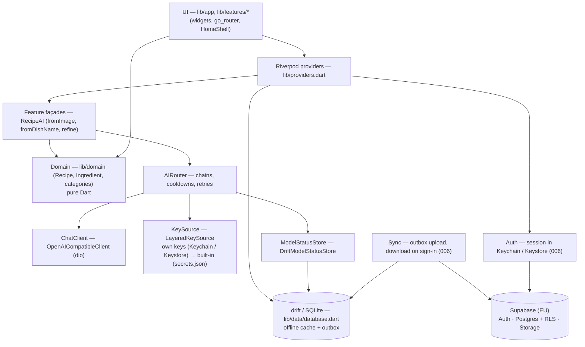
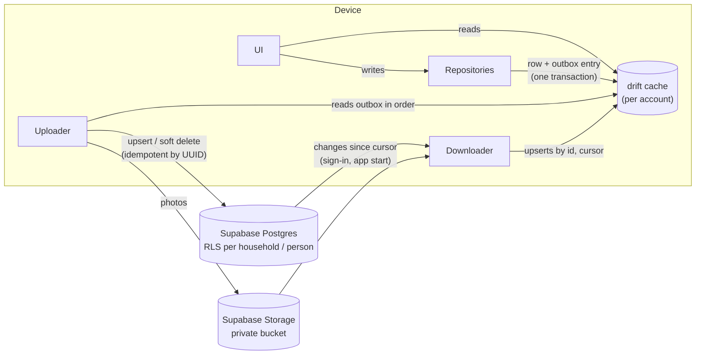
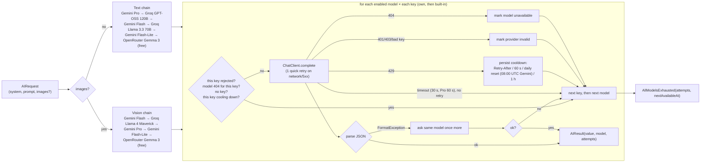

# Tavli architecture

Tavli requires an account. All user data is stored on Supabase (EU region)
under the account; the local drift database is the offline cache the UI reads
from. Specs: `specs/006-account-login/` (account, server storage, outbox).
Sections marked *(006, planned)* describe the target design; details are fixed
in the 006 `plan.md`.

## Layers

- **UI** reads state through Riverpod and never calls `ChatClient` or providers directly.
- **Domain** is pure Dart; `Recipe.fromAiJson` throws `FormatException` on bad AI output.
- **Data**: one drift database (`tavli`) with tables for recipes, recipe versions,
  pantry, shopping lists/items, meal plans/entries, ratings, user profile,
  app settings and model status. Lists inside rows (ingredients, steps, meal
  types) are stored as JSON text. User-data tables are a cache of the server
  (see "Account and server storage"); app settings (theme) and model status stay
  device-only.
- **Recipes** (spec 003): `RecipeRepository` (`lib/data/recipe_repository.dart`)
  owns recipe rows and versions. Every change (AI, manual, restore) stores the
  *previous* state in `RecipeVersions` with `changeKind`/`instruction`/`changedBy`
  (max 30 per recipe); undo applies and deletes the newest version, restore keeps
  the current state as a new version. Photos are downscaled to JPEG (≤ 1600 px)
  in an isolate and stored as files under `<documents>/recipe_photos/`; the DB
  keeps the relative path (`RecipePhotoStore`).

## Account and server storage *(006, planned)*

- **Sign-in**: passwordless email with a 6-digit code (006a); Apple and Google
  (006b). The session lives only in Keychain / Keystore and is renewed
  automatically. Without a session only the intro and sign-in are reachable.
- **Ownership**: at sign-up the server creates a profile, a personal household
  ("Moje domaćinstvo") and an owner membership. Household data (recipes,
  versions, photos, shopping lists, pantry, meal plans) belongs to a household;
  personal data (profile, ratings, preferences) belongs to the person.
- **Writes**: repositories write the drift row and an outbox entry in one
  transaction; ids are client-generated UUIDs so retries never duplicate. The
  uploader sends the outbox in order when online; a permanently rejected entry
  is parked and reported, it does not block the rest.
- **Reads**: the UI only reads drift. On sign-in the account's data is
  downloaded; on app start (and foreground after ≥ 15 min) changes since the
  last cursor are fetched. Until 009 the last write to reach the server wins per
  record; deletes are soft deletes and win over edits.
- **Per-account cache**: cached rows are scoped to the account; sign-out removes
  only the session (data stays on the server and in the cache, hidden), another
  account sees only its own data. Data that predates accounts is moved once into
  the first account that signs in on the device.
- **Delete account**: server-side deletion of the profile, membership,
  household data, photos and auth identity (no service-role key in the app),
  then the device cache, outbox, photos and own AI keys. Theme and model
  cooldowns stay on the device.
- **Security**: RLS on every table (person or household membership), explicit
  `GRANT`s to `authenticated`, nothing for `anon`, new tables not auto-exposed;
  private Storage bucket with the same rule. Policies are tested with
  `supabase test db` against the local stack.
- **Later**: 008 adds invites and roles; 009 adds realtime updates between
  household members and conflict handling for simultaneous edits.

## Local development backend

`supabase start` in the repo root runs the local stack from
`supabase/config.toml` on ports 5532x (API 55321, DB 55322, Studio 55323, mail
catcher 55324) so it does not clash with other local Supabase projects.
`supabase status` prints the local URL and anon key for your own gitignored
`secrets.json`. Migrations live in `supabase/migrations/`, the Serbian sign-in
email in `supabase/templates/`.

## Navigation

`StatefulShellRoute.indexedStack` with five tabs: Recepti, Plan, Ostava,
Kupovina, Profil. `HomeShell` shows a bottom `NavigationBar` below 720 px and a
`NavigationRail` at ≥720 px (extended at ≥1000 px). `/profile/ai-keys` is the
AI keys screen.
*(006, planned)* A `go_router` redirect sends every route to the sign-in flow
(`/sign-in`, then the mandatory name step) while there is no session or no saved
name; after sign-in the originally requested route opens.

Recipe routes: `/recipes` (list), `/recipes/new/{name,photo,manual}`,
`/recipes/:id` (detail), `/recipes/:id/edit`, `/recipes/:id/chat`. When the
content area is ≥ 840 px wide, `/recipes/:id` shows the list and the recipe side
by side (`RecipeRoute`), otherwise the detail is a full screen.

## AI router and fallback chains

Key points:

- Chains live in `ChainConfig` (`defaults`), filtered by `enabled` and, for
  vision, `supportsVision`. The config is read through a function so the user
  can change it at runtime.
- For each model the router tries every credential from `KeySource` in order
  (own key, then built-in Tavli key) before moving to the next model.
- Cooldowns and per-day request counts persist in the `ModelStatuses` table
  per (provider, model, key origin) and survive restarts.
- Rejected keys / missing models are remembered in memory per key origin.
  `invalidProviders` reports only rejected *own* keys; `resetProvider`
  (called when the user saves a new key) clears own-key state only.
- Errors thrown by `parse` other than `FormatException`/`TypeError` (e.g.
  `NotARecipeException`) stop the chain and reach the UI.
- `aiErrorText` maps every error to a Serbian message.

## Secrets

Supabase URL and anon key come from the gitignored `secrets.json` (empty
placeholders in `secrets.example.json`); the anon key is public by design and
safe only because of RLS. The service-role key is never in the app or repo.

Keys are entered by the user on the AI keys screen (spec 004): one generic
field, the service is detected from the key prefix (`AIza` Gemini, `gsk_` Groq,
`sk-or-` OpenRouter) or picked by the user, and the key is checked with the
free model-list request before saving. Any number of keys per service is
stored as one JSON list under `api_keys` in `flutter_secure_storage`
(old `api_key_<provider>` entries are migrated on first read). Own keys of a
service are tried in add order, then the built-in key; pauses and rejections
are tracked per key (`keyOrigin` column holds `user:<id>` / `builtIn`). The UI
shows only the last 4 characters. Nothing secret is in the repo.

Built-in keys (spec 002) come from a local, gitignored `secrets.json` passed
with `--dart-define-from-file=secrets.json` (see `secrets.example.json`), read
by `BuiltInKeys.fromEnvironment()`. User-entered keys take priority. The
built-in key is never shown in the UI. Later a Cloudflare Worker proxy replaces
`BuiltInKeys` behind the same `KeySource` seam, so the app ships without keys.
