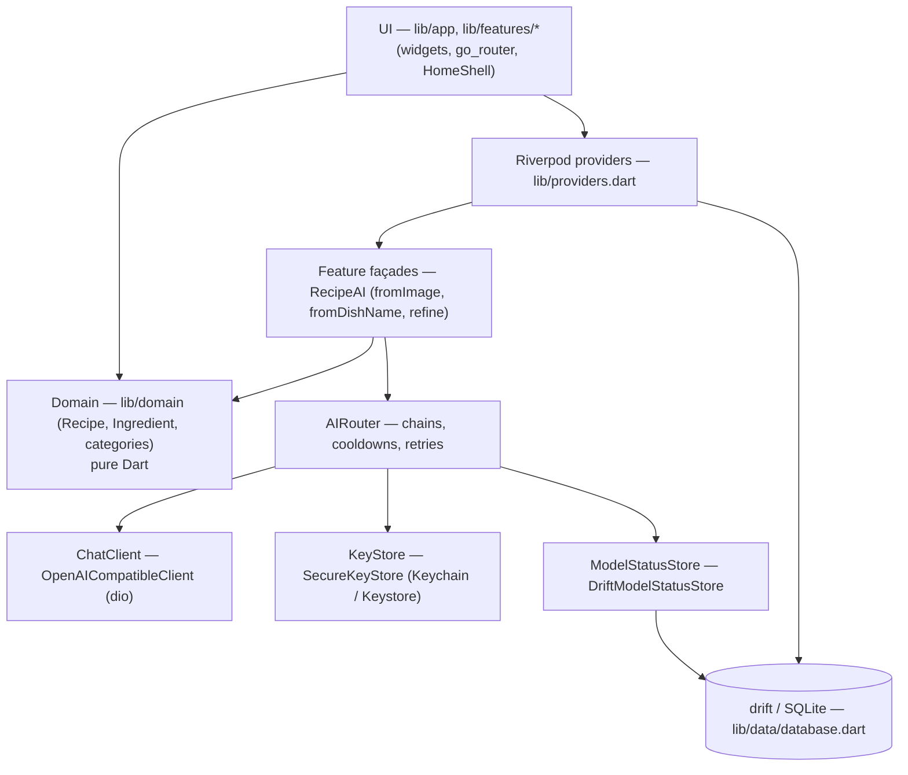
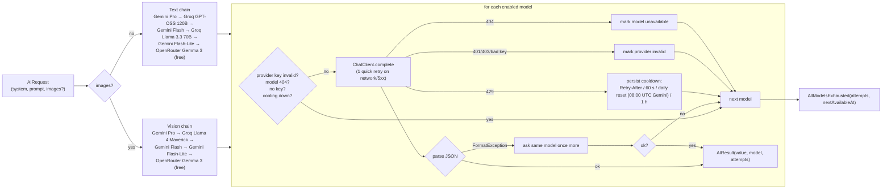

# Tavli architecture

## Layers

- **UI** reads state through Riverpod and never calls `ChatClient` or providers directly.
- **Domain** is pure Dart; `Recipe.fromAiJson` throws `FormatException` on bad AI output.
- **Data**: one drift database (`tavli`) with tables for recipes, recipe versions,
  pantry, shopping lists/items, meal plans/entries, ratings, user profile,
  app settings and model status. Lists inside rows (ingredients, steps, meal
  types) are stored as JSON text.

## Navigation

`StatefulShellRoute.indexedStack` with five tabs: Recepti, Plan, Ostava,
Kupovina, Profil. `HomeShell` shows a bottom `NavigationBar` below 720 px and a
`NavigationRail` at ≥720 px (extended at ≥1000 px). `/profile/ai-keys` is the
AI keys screen.

## AI router and fallback chains

Key points:

- Chains live in `ChainConfig` (`defaults`), filtered by `enabled` and, for
  vision, `supportsVision`. The config is read through a function so the user
  can change it at runtime.
- Cooldowns and per-day request counts persist in the `ModelStatuses` table and
  survive restarts.
- Invalid providers / missing models are remembered in memory until
  `resetProvider` (called when the user saves a new key).
- Errors thrown by `parse` other than `FormatException`/`TypeError` (e.g.
  `NotARecipeException`) stop the chain and reach the UI.
- `aiErrorText` maps every error to a Serbian message.

## Secrets

Keys are entered by the user on the AI keys screen and stored with
`flutter_secure_storage` under `api_key_<provider>`. Nothing secret is in the
repo. Bundled default keys are an open decision (see `roadmap.md`).
