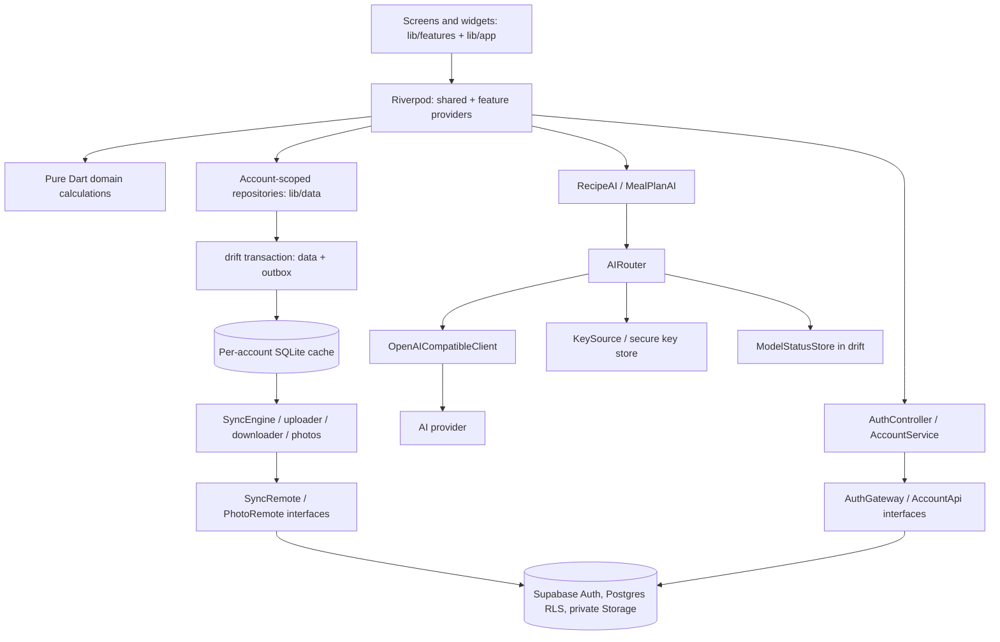
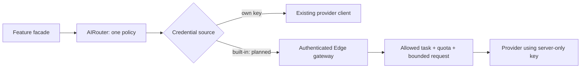

# Tavli application architecture

Reviewed: 2026-11-13. Evidence baseline: `main` at `1eca2c3`, `dev` at
`207c94c`. This describes **anjahubac/tavli**, not `tavli-next`.
Code presence is not a claim of production acceptance or a successful test run.
See [review findings](development/review-2026-11-13.md) and
[product plan](product-plan.md) for the accepted evolution.

## 1. Current stack and repository layout

One Flutter application targets Android, iOS and macOS. Windows is a planned
fourth target; this baseline has no `windows/` folder. Dart's constraint is
`^3.13.7` in `pubspec.yaml`; obtain exact packages from `pubspec.lock`, not this
prose. Material 3, Riverpod, go_router, drift/SQLite, dio, the pure-Dart Supabase
client, secure storage and image_picker are already used. No new framework,
package layout or generic event bus is required by the team standards.

| Existing path | Responsibility | Boundary |
| --- | --- | --- |
| `lib/main.dart`, `lib/app/app.dart` | ProviderScope, MaterialApp and lifecycle | App composition, not feature business rules |
| `lib/app/router.dart`, `home_shell.dart`, `tab_app_bar.dart` | Routes, adaptive shell, shared top bar | Dev 4 coordinates route changes |
| `lib/app/theme/`, `lib/app/animations/` | Palettes, semantic colors, persisted appearance and reduced motion | Reuse existing tokens/painters |
| `lib/providers.dart` | Shared dependency wiring, auth scope, sync/router/client construction | Feature-level providers remain beside their features |
| `lib/features/recipes/` | Recipe list/detail, inputs, AI preview/chat, original photo and versions | Compose reusable ingredient/personal/cooking widgets here |
| `lib/features/planning/` | Setup, draft progress/preview, calendar and meal actions | Draft state is separate from accepted plan data |
| `lib/features/shopping/` | Plan/recipe mode, list UI and providers | Reconciliation is in repositories/domain |
| `lib/features/account/`, `settings/` | Auth screens, sync status, profile, appearance and keys | No direct backend calls in widgets |
| `lib/domain/` | Pure Dart recipes, calendar dates, meal plans, demand, sources, sync and allocation calculations | No Flutter or network imports |
| `lib/data/` | Account-scoped repositories, drift schema, photos, settings and cooldown persistence | Persistent business operations and transactions |
| `lib/account/` | AuthGateway, AccountApi/Service, AuthController, AccountScope, SessionStore | Supabase hidden behind fakeable interfaces |
| `lib/ai/` | Task facades, prompts, parsers, AIRouter, ChatClient, chains and credentials | All feature AI goes through AIRouter |
| `lib/sync/` | SyncedWriter, registry, uploader/downloader, photos, legacy migration and scheduler | Network synchronization, not UI state |
| `supabase/migrations/`, `tests/`, `functions/`, `templates/` | SQL/RLS, pgTAP, delete-account and email templates | Applied SQL immutable; hosted changes via reviewed deployment |
| `test/`, `scripts/` | Mirrored tests, fake backend/AI, format/analyze and affected tests | Synthetic data, local services only |
| `specs/`, `.specify/`, `.claude/skills/` | Acceptance, contracts, workflow templates and installed Spec Kit commands | Versioned product/engineering decisions |

Pantry tables and `lib/data/pantry_repository.dart` exist. A completed pantry
feature folder, food catalog, preferences UI, household invitation flow, Home
screen, tracker, cookbooks and voice agent do not exist at this baseline.
Create their feature files only when the relevant feature is specified.

## 2. Dependency boundaries

The UI reads drift-backed streams through Riverpod; widgets forward intent to
services/repositories. UI never fetches Supabase tables or calls an AI provider.
Domain calculations are deterministic; clocks/transports are injected. Existing
shared providers stay in `lib/providers.dart`; do not invent a parallel DI layer.

## 3. Account and data lifecycle

An account is mandatory. Auth states (`Starting`, `SignedOut`, `CodeSent`,
`NeedsName`, `SignedIn`) control route access and the one-time name step. Email
code is the current method; Apple/Google remain future work. Session tokens live
in secure storage, not drift or logs. Email OTP length, confirmation templates
and redirect settings must agree for each local/dev/production environment;
configure them explicitly rather than assuming the email template determines
code length. Never inspect real session/credential values during tests.

Supabase is the durable account-backed store. drift is the UI's working cache,
not a second independent source of business truth. Household records include
recipes, plan, pantry and shopping; personal records include profile/ratings.
Every read/write uses `AccountScope`. Sign-out clears access/session without
removing server or per-account cached data. Account deletion is a separate
explicit operation through `delete-account`, then local cleanup after success.

### Writes, retry and reads

1. User confirms a business operation.
2. Repository validates current state and computes domain changes.
3. One drift transaction writes rows and outbox entries through `SyncedWriter`.
4. UI immediately observes the local result; `SyncEngine.kick()` schedules upload.
5. `Uploader` reads current payloads for queued identities; UUID identities make
   retry idempotent. Rejected entries are reported rather than blocking all work.
6. `Downloader` applies account-scoped pages/cursors, preserving pending local
   edits. Photos synchronize separately so a photo cannot block ordinary data.

Current scheduler pushes on start/login/resume/local change, debounces local
writes for 1 s and retries offline at 5/10/30 s. Pull runs on start/login and
resume when the 15-minute threshold has elapsed. This is **not** a claim that
an active foreground polling timer or household realtime already exists.
Last server write wins for record edits; deletion tombstones prevent resurrection.
Future realtime is an authenticated invalidation signal that triggers the same
pull path, with reconnect recovery. It never becomes an alternative UI database.

Shared catalog/prices will download as read-only reference data; household-owned
additions remain ordinary outbox-backed writes. Current theme/settings and AI
keys remain device-local. Planned cycle data is a deliberate device-only secure
exception; do not add it to the generic sync/export pipeline.

## 4. Existing planning and shopping invariants

`MealPlanAI` and planning feature providers generate in-session drafts. Approval
persists through `MealPlanRepository`. The current `MealType` has breakfast,
lunch and dinner; the target adds two snacks and a list-based representation.
`CivilDate` already represents calendar days in domain code, while persisted
calendar columns still need the planned server `date` migration.

The baseline drift schema version is **5** (`lib/data/database.dart`). It already
includes approved recipe snapshots/servings, source headers, contributions,
supply allocations, pantry receipt provenance and weekly shopping periods.
This is not permission to choose version 6 independently in four branches;
check current `dev` and coordinate the next version before each schema PR.

- Plan entries reference the approved snapshot. Later library changes/deletion
  must not silently change shopping quantities or remove cooking information.
- A standalone preparation has a stable identity. Repeating Add updates only the
  difference; intentionally preparing the dish again creates a new source.
- Month view aggregates canonical weekly lists; a month may intersect six weeks.
- Demand and supply retain provenance. One pantry quantity is allocated only
  once across plan and recipe shopping. A purchase and its pantry receipt are
  the same supply, not two independent credits.
- Bought/manual rows survive reconciliation. Unknown units/quantities stay
  visible for checking; never guess a conversion silently.
- Current `PantryRepository.receiveBought` is idempotent. The new explicit
  transfer/consumption behavior is an extension, not an invitation to rewrite
  the shopping ledger without regression fixtures.

Preserve these rules during catalog normalization and shared cooking operations.
Test local rollback, duplicate event/retry, undo, account switch and deletion.

## 5. Runtime AI, current and target

Current: `RecipeAI`/`MealPlanAI` → `AIRouter` → fakeable `ChatClient` (dio).
`ChainConfig` owns models/capabilities; `KeySource` supplies own keys then built-in
credentials; model cooldown state persists in drift. Parsers throw
`FormatException` for shape/domain mismatch; the router has bounded repair and
fallback. UI receives typed errors mapped to Serbian. JSON-object decoding alone
is not sufficient semantic validation.

Target: keep the same feature/router boundaries; add a gateway transport for
built-in Tavli credentials through a Supabase Edge Function. Server validates
identity, allowed tasks, size/budget and per-user limits, then adds provider
credentials. Bring-your-own keys stay in secure device storage and can use the
existing direct transport. Do not duplicate fallback/repair policy in the UI and
server; the gateway contract must specify who owns each retry and cancellation.

After gateway acceptance, built-in provider keys must no longer ship in app
builds. Existing build-time keys are a migration risk, not a new recommended
production design. No credential-file changes or real provider calls belong in
this documentation revision.

Future cookbook/RAG processing uses private household storage and authorized
retrieval, page/chunk provenance and resumable background jobs. Future voice uses
validated allowlisted commands against a draft, then the same approval/mapping
path. Future imported plans are reviewed, preserve exact quantities and protect
locked meals. None of those workers/endpoints currently exists here.

## 6. Accepted product evolution and privacy

Target tabs: Plan, Nabavka, **Početna**, Recepti, Ostava; profile via avatar.
Current code still starts at Plan with four tabs. Home, pantry and cooking extend
existing planning/shopping repositories; they do not create a second plan store.
Keep route compatibility and auth gates during the transition.

Catalog: stable UUID + readable slug, aliases, base units, conversions and
nutrition provenance; do not copy `tavli-next` identifiers/schema blindly.
Ingredient snapshots preserve original text and optional catalog mapping.
Pantry has optional quantity, no expiry UX and no “use first” subsystem. Numeric
stock is consumed once when cooked and restored on undo; unknown stock persists
until removed. Those are future semantics to implement with a ledger contract.

Household member preferences/allergies/favorites need a purpose-limited aggregate
for planning. Do not expose personal profile or nutrition diary rows to all
members merely to build an AI prompt. The exact aggregate/consent boundary must
be accepted in the household contract before migrations. Favorites aggregation
remains an open product decision. Cycle dates never leave the device; only an
explicitly approved generic dietary hint can enter a request.

Nutrition is optional, off by default, computed from attributed reference values,
not numbers invented by AI. Personal intake/targets stay private. Cookbooks and
receipt/price integrations need source/legal/retention decisions before shipping.
See [shared contracts](../specs/011-team-development/contracts/shared-boundaries.md).

## 7. Team and verification boundaries

Dev 1 coordinates data/schema and shopping; Dev 2 owns AI/planning; Dev 3 owns
identity/personal data; Dev 4 owns shell/everyday UX/platforms. Each owns complete
feature slices in the current layers, with consumer review at shared boundaries.
No developer exclusively owns all of `lib/domain/` or `lib/data/`.

Each domain/parser change has behavioral tests; UI key flows use widget tests;
RLS/storage use two-account pgTAP locally. Fake provider/backend interfaces keep
default Flutter unit/widget tests offline. Platform smoke tests and UX evaluation remain explicit
release evidence. See [quality gates](development/quality-gates.md).

An architecture change requires a short decision record: problem, alternatives,
chosen boundary, owner/consumers, data migration and acceptance tests. Standards
must follow the verified repository, never an imagined future folder tree.

## 8. Security boundaries and known gaps

[Security assessment](development/security.md) records the source-level baseline:
RLS/grants/private storage and secure session storage exist; provider credentials
compiled into builds, unchecked photo paths, raw error propagation and missing
SQL/function deployment gates need dedicated remediation. Environment/cache
protection needs review before sensitive-data features. These are tracked in
[012](../specs/012-security-baseline/spec.md); no architecture diagram or rule
change constitutes a runtime fix. Server authorization remains mandatory even
when a modified client bypasses all Flutter validation.
